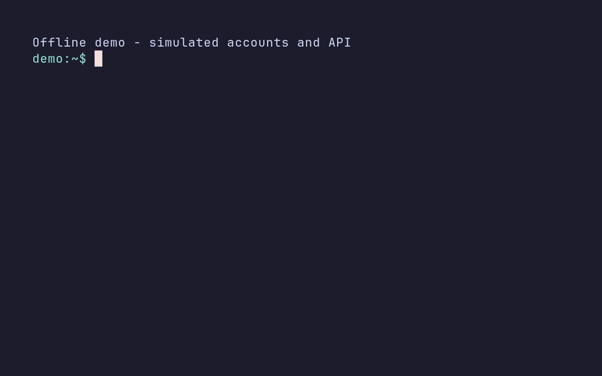

# gh-autoaccount

Directory-scoped GitHub accounts for terminals and local agents. This GitHub CLI
extension routes commands to a pinned account without switching the globally active
account. Git authentication and Git author/committer identity are separate concerns.

## Demo



[Watch the MP4](docs/demo.mp4)

Offline demonstration using simulated accounts and API responses; account selection and credential injection are performed by gh-autoaccount. It shows native setup, a default account, and a directory pin without global account switching.

## Why

GitHub CLI [added multi-account support](https://github.com/cli/cli/blob/trunk/docs/multiple-accounts.md)
in v2.40.0, but excluded automatic per-directory switching. gh-autoaccount focuses
on concurrent human and agent workspaces: command-scoped credentials, separate Git
identity checks, and no global active-account switching.

### The problem

```bash
gh auth status                         # multiple accounts already logged in
cd ~/work-project
gh auth switch --user bob              # mutates global state
```

### The solution

```bash
gh autoaccount pin bob --dir ~/work-project --git-email bob@example.test
cd ~/work-project
gh api /user --jq .login               # routes to bob
git var GIT_AUTHOR_IDENT               # inspect inside a Git repository
```

## Native onboarding

With accounts already logged in, run `gh autoaccount setup --native`, optionally
enable `setup --git-identity`, configure a default and pin a directory as shown
below. Restart the shell or apply the PATH instructions. Native wrapper-mode pins
do not require direnv or `.envrc`; export and legacy integration still do. A
default account is not a Git author identity. `gh autoaccount default --unset`
clears it, including when recovering from a missing stored credential.

## Installation

The following is a recipe for the intended first beta tag, `v0.1.0-beta.1`, not a
claim that the tag or its assets have already been published or tested. Check the
release and its checksums before proceeding. You need GitHub CLI 2.40 or later,
authenticated accounts, Git, and Bash or zsh on Linux/macOS. Native routing does
not require direnv or an `.envrc` for a fresh setup; legacy and export workflows do.
Windows binaries do not imply complete Windows shell integration.

After the tagged release and launcher exist on the new repository's `main`, try
`gh extension install mdiloreto/gh-autoaccount --pin v0.1.0-beta.1`. GitHub CLI
may reject pinned installs or upgrades while only prereleases exist because it
checks `releases/latest`. In that case use the manual binary manifest below. The
launcher requires GitHub CLI to provide `GH_PATH`, Git and SHA-256 tools; it
downloads and checks a matching release binary and caches it in `.autoaccount-cache`.
It supports Linux/macOS amd64 and arm64. If a pinned commit has multiple matching
prerelease tags, select one explicitly with `GH_AUTOPROFILE_RELEASE_TAG`.
GitHub CLI records a script extension's pinned commit rather than the requested
tag. The selected prerelease tag must exist locally and resolve to that commit;
a SHA without such a tag requires reinstalling a tagged revision. The launcher
does not automatically upgrade and verifies checksums, not provenance. Removing
an extension also removes its cached binary and can break an installed shim.

The old and new extensions have different names. Installing the new one does not
rename or remove the old one, or update your machine's shell configuration. Verify
in an isolated home first; do not remove a working extension before a replacement
is verified. A checksum from the same release detects corruption, not publisher
identity or independent provenance. Verify any claimed attestation separately.

### Manual prerelease binary manifest

Run in Bash only after the tag and release exist, using a trusted real `gh` and an
account that can access the release. This recipe supports Linux/macOS amd64 and
arm64. Use an isolated `HOME`/`XDG_DATA_HOME` for initial verification. It refuses
to overwrite any existing new-name extension; inspect that separately.

```bash
(
  set -euo pipefail
  tag=v0.1.0-beta.1
  case "$(uname -s)" in Linux) os=linux ;; Darwin) os=darwin ;; *) exit 1 ;; esac
  case "$(uname -m)" in x86_64) arch=amd64 ;; aarch64|arm64) arch=arm64 ;; *) exit 1 ;; esac
  asset="gh-autoaccount_${tag}_${os}-${arch}"
  download=$(mktemp -d "${TMPDIR:-/tmp}/gh-autoaccount-beta.XXXXXX")
  printf 'Downloads: %s\n' "$download"
  GH_AUTOPROFILE_DISABLE_SHIM=1 command gh release download "$tag" \
    --repo github.com/mdiloreto/gh-autoaccount --pattern "$asset" --pattern checksums.txt --dir "$download"
  cd "$download"
  awk -v asset="$asset" '$2 == asset { print; found++ } END { if (found != 1) exit 1 }' checksums.txt > selected.sha256
  if command -v sha256sum >/dev/null; then sha256sum --check selected.sha256; else shasum -a 256 --check selected.sha256; fi
  extdir="${XDG_DATA_HOME:-$HOME/.local/share}/gh/extensions/gh-autoaccount"
  if [[ -e $extdir || -L $extdir ]]; then printf 'Extension exists; inspect it first.\n' >&2; exit 1; fi
  mkdir -p "$extdir"
  install -m 755 "$asset" "$extdir/gh-autoaccount"
  if [[ $os == darwin && $arch == arm64 ]]; then codesign --force --sign - "$extdir/gh-autoaccount"; fi
  manifest_path=${extdir//\'/\'\'}
  cat > "$extdir/manifest.yml" <<EOF
owner: mdiloreto
name: gh-autoaccount
host: github.com
tag: $tag
ispinned: true
path: '$manifest_path/gh-autoaccount'
EOF
  chmod 600 "$extdir/manifest.yml"
  GH_AUTOPROFILE_DISABLE_SHIM=1 command gh extension list
  GH_AUTOPROFILE_DISABLE_SHIM=1 command gh autoaccount --version
)
```

The extension directory is under `XDG_DATA_HOME/gh`, defaulting to
`~/.local/share/gh`. Keep the download directory until verification is complete.
Do not execute an asset if the checksum check fails. A `404` does not by itself
distinguish an incorrect account from missing access.

## Setup and usage

Setup changes local files and optionally shell and Git configuration; review and
approve these changes separately from downloading a binary. In a fresh shell:

```bash
gh autoaccount setup --native
gh autoaccount setup --git-identity  # optional Git identity integration
gh autoaccount default alice
gh autoaccount pin bob --dir ~/work-project --git-email bob@example.test
gh autoaccount status --json
gh autoaccount list --json
```

Restart the shell or apply the setup instructions for PATH. Native setup installs a
managed `gh` shim and Git HTTPS credential helper and refuses to replace unmanaged
shim paths. `--no-shell-rc` leaves shell integration to the caller. Native wrapper
pins use the registry without direnv or `.envrc`; export mode and legacy routing
still need direnv. `setup --native=false` returns to legacy routing, retaining Git
helper and identity configuration. Setup refreshes generated runtime paths; it does
not itself rename an installed extension. Review and approve actual installation
and shell RC or Git configuration migration separately.

An optional `gh autoaccount setup --alias` configures `aa` to map exactly to
`autoaccount`. It never overwrites an existing alias: a clash warns and retains
the existing mapping, while the literal command remains available. Only that exact
configured mapping receives native no-auth recovery bypass; arbitrary aliases do
not. In the tested GitHub CLI version, `gh extension exec autoaccount` requires
authentication; use the literal `gh autoaccount` command for no-auth recovery.

```bash
gh autoaccount default --unset
gh autoaccount exec --require-pin --expect-user bob --verify-identity -- gh pr status
gh autoaccount unpin ~/work-project
gh autoaccount doctor
```

Without `--require-pin`, selection precedence is explicit `exec --user`, then the
deepest real directory pin, then the configured `github.com` default, then
unselected legacy behavior. `--require-pin` requires and retains an actual matching
pin, not a default, including its host, token command, identity and SSH metadata;
a conflicting `--user` is rejected. Explicit `--user` without `--require-pin` does
not inherit pin metadata; the default does not inherit pin metadata either. External
Git configuration still applies. `--expect-user` checks
the selected profile; `--verify-identity` checks the remote login. A Git author
identity is not proof of the authenticated remote account. `--require-pin` rejects
missing pins before the child runs. Explicit `exec` passes credentials to the child
and descendants; it is not a sandbox. Export mode deliberately exposes tokens to
the shell and its children. Never share tokens or private keys in diagnostics.

## Compatibility and safe migration

The `~/.config/gh-autoprofile` storage and files, `GH_AUTOPROFILE_*` environment
variables, existing managed `.envrc`, RC and PATH markers, `use_gh_autoprofile`
shell APIs, and managed helper/identity signature paths intentionally retain their
names for compatibility. This is not an incomplete migration. Never blindly sed
or broadly rename the old configuration.

Managed or malformed old wrapper `.envrc` content blocks native setup, pin, unpin
and migration before state changes; inaccessible inspection errors fail closed.
Review the entire file first, manually run `direnv deny`, remove only the managed
block while preserving all custom bytes, reload the shell and clear old exports,
then retry. There is no automatic cleanup or recovery backup. These checks do not
provide a sandbox or prevent concurrent same-user races. Review any proposed
`setup --migrate` or `doctor --fix` separately before running it.

### Refresh after an upgrade

After verifying the replacement and reviewing the proposed configuration changes,
run `GH_AUTOPROFILE_DISABLE_SHIM=1 command gh autoaccount setup --migrate`, then
restart the shell or reload its RC file. Migration refreshes installed library,
hook and previously configured helper/shim assets, backfills missing pin modes,
regenerates enabled identity includes and respects external-shell preferences.
Legacy/export managed blocks may be updated; automatic `direnv allow` is conditional
on file inspection and safety checks. Unmanaged content requires manual review and
allow. Native managed or malformed old wrapper blocks instead stop the operation
before changes and require the manual preflight above, without automatic backups.

## How it works

GitHub CLI supports multiple accounts, but directory routing avoids changing its
global active account as you move between workspaces. Native routing selects pins
directly. Legacy wrapper mode uses direnv to export non-sensitive profile markers;
the prompt hook creates `gh()` and `git()` functions which re-resolve the trusted
pin and inject its token only into the child. Prompt hooks need not run in editor
tasks, agents, cron or non-interactive shells. Use native routing, the managed
credential helper, or guarded `exec` in those contexts.

The Git HTTPS helper does not inject new credentials into local Git commands or
hooks, but does not remove credentials inherited from the caller. `exec` injects
the selected token into the arbitrary child and descendants. Export mode uses
direnv to expose tokens to the shell and children for third-party tools. None of
these is a sandbox against malicious commands or same-user processes.

### Native routing (primary, opt-in on Linux and macOS)

```bash
gh autoaccount setup --native
gh autoaccount setup --git-identity  # separate opt-in for author/committer identity
```

Native setup installs a managed `gh` symlink and configures the GitHub HTTPS
credential helper; it refuses to replace unmanaged paths at the shim location.
Plain `gh` and Git HTTPS select pins directly without direnv, a shell hook or
profile marker at runtime. The shim directory must be on PATH; with `--no-shell-rc`,
manage PATH and hook sourcing externally. Setup still installs the direnv library
and hook for existing workflows. Export mode and environment-based Git identity
still require direnv; `--git-identity` separately enables Git's `includeIf`
integration. Windows retains legacy integration.

Run `gh autoaccount setup --native=false` to restore legacy shim and wrappers,
then reload the hook or restart the shell. This retains configured Git helper and
identity settings; the helper continues routing Git HTTPS through pins. The switch
can complete without direnv, but legacy wrappers and export need direnv to activate.
`setup --migrate` and `doctor --fix` preserve the selected routing mode.

### Wrapper mode (default)

1. Legacy direnv exports only non-sensitive profile markers and clears conflicting
   GitHub token and host variables for the directory session.
2. A shell hook creates `gh()` and `git()` wrapper functions on each prompt.
3. Each wrapper re-resolves the trusted directory pin, injects its matching
   host-class credential only into the child process and runs the real command.
4. The injected token does not sit in the parent shell environment.

For non-interactive shells, use the explicit execution path:

```bash
gh autoaccount exec --require-pin --expect-user bob --verify-identity -- gh pr status
gh autoaccount setup --gh-shim
gh autoaccount setup --credential-helper
```

The optional PATH-level shim supports plain `gh`; the helper supports plain GitHub
HTTPS `git fetch`, `git pull` and `git push` without prompt-cycle wrappers.

### Export mode (opt-in for third-party tools)

Direnv exports the selected host class's token pair into the shell environment so
third-party tools can read it. Use `--export-token` when pinning directories that
need it. Opt-in helper and Git identity setup modify global Git configuration but
do not switch the globally active `gh` account.

### Externally managed shells

```bash
gh autoaccount setup --no-shell-rc
gh autoaccount setup --no-shell-rc --gh-shim --credential-helper --git-identity
```

`--no-shell-rc` persists external-shell mode in
`$XDG_CONFIG_HOME/gh-autoprofile/settings.yml` (default
`~/.config/gh-autoprofile/settings.yml`). Setup installs library and hook files,
but does not create, edit or remove RC files or PATH blocks, including existing
managed blocks. Later setup, migration and `doctor --fix` respect this preference;
`setup --no-shell-rc=false` explicitly restores automatic RC integration.

Through your shell manager, configure the direnv hook, source the installed
`gh-autoprofile/hook.sh`, and put `~/.local/bin` before the real `gh` on PATH if
using the shim. Installing a shim does not activate it on PATH. Status and doctor
report external integration as not verified: a subprocess cannot verify the parent
shell's wrappers, even if old RC markers exist.

### Git-native identity

```bash
gh autoaccount setup --git-identity
gh autoaccount pin bob --dir ~/work --git-name "Bob Example" --git-email bob@example.test
git -C ~/work/my-repo var GIT_AUTHOR_IDENT
git -C ~/work/my-repo var GIT_COMMITTER_IDENT
```

This persistent opt-in creates a main include and per-pin fragments under
`$XDG_CONFIG_HOME/gh-autoprofile/git-identity/`. Git registers the main include at
the end of its effective global config, respecting `GIT_CONFIG_GLOBAL` and Git's
XDG/global selection. Existing settings and unrelated includes are preserved; no
repository-local Git config is written. Exact-value registration requires Git 2.30+.

Identity fields generate `includeIf "gitdir:..."` rules with directory boundaries;
parents appear first and the deepest pin's supplied fields win. Omitted fields can
inherit from parent/global Git config. Account-only pins and tracked `.envrc` files
containing only `use_gh_autoprofile <account>` do not erase Git-native identity.
Git handles these includes without a shell or direnv session.

Setup with `--git-identity` also migrates managed `.envrc` blocks to stop exporting
identity variables. Pin, unpin and migration regenerate includes and publish files
atomically. Superseded immutable identity fragments are deliberately retained for
Git processes that read an older include; unpin removes references, not fragments.
They contain identity values, not credentials. Registry/settings publication is
serialized with `mutation.lock`; concurrent commands fail with a retry message,
and global config publication respects Git's `.lock` protocol. Remove a stale lock
only after confirming no writer is running; the error reports PID and age. Reload
direnv or start a fresh shell after migration to clear old identity exports.

Migration automatically runs `direnv allow` only when the `.envrc` has no content
outside managed markers and the safety checks pass. Otherwise review the full file
and allow manually. The native old-wrapper blocker described above takes precedence;
do not assume migration rewrites or auto-cleans such a file.

Repository-local `user.name`/`user.email`, command-scoped config and explicit
`GIT_AUTHOR_*`/`GIT_COMMITTER_*` variables can override global identity includes.
Managed mode does not remove explicit environment values or rewrite unmanaged
content. Without this opt-in, pin identity is environment-based and
`git config user.email` does not show the environment values.

Linked worktrees match their actual Git directory, often under the original
repository's `.git/worktrees/`, not necessarily the checkout path. Inspect
`git rev-parse --absolute-git-dir` and verify both `git var` identities in the
target context. Identity selection is separate from account/auth selection.

### Pin options and credential sources

```bash
gh autoaccount pin alice --dir ~/personal-projects
gh autoaccount pin bob --dir ~/work --git-email bob@example.test --git-name "Bob Example"
gh autoaccount pin alice --dir ~/project --ssh-key ~/.ssh/id_example
gh autoaccount pin bob --dir ~/infra --export-token
gh autoaccount pin bob --dir ~/enterprise --host github.example.com \
  --token-command /absolute/path/to/trusted-broker
gh autoaccount list
gh autoaccount status
gh autoaccount doctor
```

Pins match canonical physical directories, including symlink aliases; the deepest
match wins. Accounts are identified by `(host, user)`, with missing host defaulting
to `github.com`. A `token_command` is a trusted absolute executable invoked without
a shell per command, with sanitized credential variables, a timeout and bounded
single-token output. It is authoritative: failure never falls back to ambient or
keyring credentials. Trust the executable and its dependencies.

The remote verifier accepts GitHub Enterprise Managed User logins in GitHub's
`LOGIN_SHORTCODE` form (one underscore, alphanumeric shortcode, at most 39 total
characters); the API must return the complete login. The registry rejects unknown
fields. An older binary that predates `host` or `token_command` cannot read a
registry containing them; remove those fields with the current binary or restore a
reviewed backup before rollback.

`doctor --fix` changes configuration and should be reviewed separately. Doctor
reports shell library/hook health, shim and PATH, helper configuration, persisted
external-shell mode, identity include registration and managed `.envrc` status.

### Token and host boundaries

Wrapper mode uses `GH_AUTOPROFILE_USER` and `GH_AUTOPROFILE_MODE` as non-sensitive
markers; optional identity fields set `GIT_AUTHOR_EMAIL`, `GIT_COMMITTER_EMAIL`,
`GIT_AUTHOR_NAME`, `GIT_COMMITTER_NAME` and `GIT_SSH_COMMAND`. With Git-native
identity enabled, managed blocks use Git config instead. Explicit identity
environment variables remain Git overrides.

Native `gh` receives only the selected host class's primary token: `GH_TOKEN` for
`github.com` and `*.ghe.com`, or `GH_ENTERPRISE_TOKEN` for other Enterprise hosts.
A non-default host also receives `GH_HOST`. Explicit `exec` supplies the matching
primary/fallback pair (`GH_TOKEN`/`GITHUB_TOKEN` or
`GH_ENTERPRISE_TOKEN`/`GITHUB_ENTERPRISE_TOKEN`) to its child and removes conflicting
token and host variables. These variables select a host class, not an exact host:
an arbitrary child targeting another host in that class may consume the same token.
The Git HTTPS helper resolves credentials only for its exact host.

Export mode intentionally places the matching token pair and non-default `GH_HOST`
in the directory environment. It resolves the named pin by default. A headless
caller may explicitly trust an ambient token with `GH_AUTOPROFILE_ALLOW_AMBIENT_TOKEN=1`.
Without a broker, ambient ownership is accepted only when both ownership markers
are absent (first use), or both `GH_AUTOPROFILE_USER` and `GH_AUTOPROFILE_HOST`
match the selected `(host, user)`. A partial or mismatched pair instead resolves the
configured credential. A `token_command` remains authoritative regardless of opt-in.
Ambient opt-in asserts ownership; it does not verify token identity.

### Non-interactive Git and limitations

```bash
gh autoaccount setup --credential-helper
gh autoaccount exec --require-pin --expect-user bob --verify-identity -- git fetch
```

The optional path-aware helper supports GitHub HTTPS without prompt hooks. Inspect
existing Git credential configuration before changing it; manual
`git config --global --replace-all credential.https://github.com.helper ''` does
not preserve existing helpers. Enterprise hosts require exact-host helper sections.
The helper fails closed if selected credentials cannot be resolved. Different hosts
do not receive that credential. SSH and author identity are separate.

Credential lookup occurs per invocation; there is no token cache. Headless `gh auth
token` keyring access may require a D-Bus session. Make the keyring available, or
use export mode with the explicit ambient-token opt-in and ownership rules above.
Without native routing, helper or `exec`, ordinary global gh/Git behavior applies
outside interactive legacy wrappers. Setup-generated routing paths pin a trusted
absolute real `gh` and extension path; externally supplied absolute `GH_PATH` or
the startup PATH must be trusted. Same-user replacement remains outside the boundary.
See [SECURITY.md](SECURITY.md) for shebang, path and auto-allow limitations.

### Managed files

The registry and settings live under `~/.config/gh-autoprofile/` by default,
alongside `hook.sh`, `git-credential-helper` and optional `git-identity/` includes.
The direnv library is under `DIRENV_CONFIG/lib`, otherwise
`XDG_CONFIG_HOME/direnv/lib` or `~/.config/direnv/lib`. Legacy `.envrc` blocks use
`# gh-autoprofile:start` and `# gh-autoprofile:end`; custom content must be preserved.
The registry is written with mode 0600 and the config directory with mode 0700.

## Usage

### Pin an account to a directory

```bash
# Basic wrapper mode: token is not exported into the parent environment.
gh autoaccount pin alice --dir ~/personal-projects

# Git identity and, separately, an SSH key:
gh autoaccount pin bob --dir ~/work \
  --git-email bob@example.test --git-name "Bob Example"
gh autoaccount pin alice --dir ~/personal \
  --git-email alice@example.test --ssh-key ~/.ssh/id_example

# Export for third-party tools, or use a trusted host-specific broker:
gh autoaccount pin bob --dir ~/infra --export-token
gh autoaccount pin bob --dir ~/enterprise --host github.example.com \
  --token-command /absolute/path/to/trusted-broker
```

Pins match canonical physical directories, including through symlink aliases, and
the deepest matching pin wins. Account identity is `(host, user)`, defaulting a
missing host to `github.com`. The broker is an authoritative trusted absolute
executable, run without a shell with sanitized credentials, a timeout and bounded
single-token output; failure never falls back. An older binary that predates
`host` or `token_command` cannot read those registry fields: remove them with the
current binary or restore a reviewed backup before rolling back.

### Owner pins

A directory pin cannot help when Git is run from elsewhere: Git runs credential
helpers in the invoking directory, so `git clone https://github.com/work-org/x ~/work/x`
from `~` authenticates as the default account, not the `~/work` pin. Pin the
organization or user instead:

```bash
gh autoaccount pin bob --owner work-org --git-email bob@example.test
gh autoaccount unpin --owner work-org            # add --host for Enterprise
```

An owner pin has an `owner` and no `dir`; it is wrapper-mode only, never writes
`.envrc`, matches the owner case-insensitively and is unique per `(host, owner)`.
An older binary rejects a registry containing owner pins (unknown `owner` key).
Selection precedence everywhere is: `exec --user`, then the owner pin for the
accessed repository, then the deepest directory pin, then the configured default.
The owner comes from the Git credential request path, gh's `-R/--repo`,
`GH_REPO`, the target of `gh repo clone` (which ignores both `-R` and `GH_REPO`),
then the working directory's remote: the one marked `gh-resolved`, else
`upstream`, `github`, `origin` (gh's order), else the only remote. gh's flag table
is not known here, so an `-R`/`--repo` right after another flag (`=` or not) could
be that flag's value, and a repeated `-R` is resolved by gh to its last value. In
those cases, and for an unparseable `-R`/`GH_REPO` or a bare `gh repo clone REPO`,
the target is unknown: owner routing is skipped for that command and the
directory pin or default applies. Put `-R` before other flags or right after a
positional argument to route by it. `exec --require-pin` accepts an owner or a
directory pin.

With `setup --git-identity`, `git_email`/`git_name` on an owner pin apply to
repositories with a remote URL (https or ssh, with or without userinfo or a
port, or scp-style) under that owner, and win over directory identity;
this needs Git 2.36 or newer, and setup and doctor refuse or flag older Git.
Known limitation: Git can only match `remote.*.url`, so identity matches every
remote while credentials follow the one selection above. A checkout with a
remote under an owner pin that credentials do not select (another remote wins,
or several owner pins match) can therefore disagree, and `status` warns about it
(`conflicting_owner_pins` in `--json`).

For the Git path, setup and pin also set `credential.https://<host>.useHttpPath=true`
on hosts that have an owner pin, because Git omits the repository path from
helper requests otherwise; an explicit `false` is overwritten with a note. It is
never unset automatically, even after the last owner pin is removed. Every other
helper in the chain, including the `gh auth git-credential` fallback, then sees
per-path requests; credential stores that key on the path keep one entry per
repository. `doctor` reports a missing setting only for hosts with owner pins and
`doctor --fix` restores it.

### List all pins

```bash
gh autoaccount list
gh autoaccount list --json
```

Human-readable output lists directory, account, host, whether a token command is
configured, mode, Git email/name and SSH key; `*` marks the current directory.
The command path of a token broker is not exposed in JSON output.

```text
DIRECTORY      ACCOUNT  HOST        TOKEN COMMAND CONFIGURED  MODE     GIT EMAIL
  ~/personal   alice    github.com  false                     wrapper  -
* ~/work       bob      github.com  false                     wrapper  bob@example.test

2 pin(s) total. (* = current directory)
```

The table excerpt omits the Git name and SSH key columns shown by the command.

### Check current status

```bash
gh autoaccount status
gh autoaccount status --dir ~/work-project --json
```

Status reports the selected directory and pin, local credential availability,
environment markers, tooling and actual Git identity diagnostics. Both
human-readable and JSON status are local-only: they do not probe remote login or
scopes. Actual Git diagnostics reflect current config and environment, not
hypothetical identity injected into a later child. JSON has `schema_version: 1`;
inspect errors even when the command succeeds. See the [JSON contract](docs/agent-shell-support-plan.md#local-json-versus-remote-verification).

For example, an excerpt from local JSON might contain:

```json
{
  "schema_version": 1,
  "directory": "/home/user/work-project",
  "pin": {
    "user": "bob",
    "host": "github.com",
    "token_command_configured": false,
    "directory": "/home/user/work-project",
    "mode": "wrapper"
  },
  "authentication": {
    "selected": true,
    "source": "keyring",
    "credential_available": true,
    "verified": false
  }
}
```

This illustrative excerpt omits other fields. In particular, `verified: false`
is expected for local status even when a credential is available; use
`--verify-identity` for remote verification.

### Run a command in a pinned profile context

```bash
# Deterministic for AI tool shells, CI, editor tasks and scripts:
gh autoaccount exec --require-pin --expect-user bob --verify-identity -- gh pr status

# Works for Git too, with command-scoped authentication and identity injection:
gh autoaccount exec --require-pin --expect-user bob --verify-identity -- git fetch
```

### Agent preflight

Check `exec --help`, `status --help` and `list --help` on the executable used:

```bash
gh autoaccount status --dir ~/work/my-repo --json
gh autoaccount exec --dir ~/work/my-repo --require-pin --expect-user bob --verify-identity -- gh api --hostname github.com user --jq .login
gh autoaccount exec --dir ~/work/my-repo --require-pin --expect-user bob --verify-identity -- git var GIT_AUTHOR_IDENT
gh autoaccount exec --dir ~/work/my-repo --require-pin --expect-user bob --verify-identity -- git var GIT_COMMITTER_IDENT
```

`--require-pin` requires a real directory pin and retains it. In this strict
workflow omit `--user`: it cannot silently substitute another profile.
`--expect-user` checks the selected profile name case-insensitively, not remote
token identity. Credential selection follows the pin's mode and ownership-marker
rules. `--verify-identity` verifies the remote principal before running the child;
remote identity does not prove repository authorization. Compare both Git identities
separately before approving writes. JSON is local-only, not proof of access or
parent-shell activation. `--dir` also sets the child's working directory. Without
`--require-pin`, explicit `--user` does not inherit pin host, broker,
identity or SSH metadata; external Git config still applies. See the
[agent contract and linked-worktree caveats](docs/agent-shell-support-plan.md).

### Plain `git` in pinned directories

After opting in with `gh autoaccount setup --credential-helper`, matching-host
GitHub HTTPS operations use the selected directory pin, including inherited child
directories and non-interactive shells without prompt-cycle functions:

```bash
cd ~/work-project
git fetch
git push
```

### Validate installation health

```bash
gh autoaccount doctor
gh autoaccount doctor --fix  # changes configuration; review first
```

Doctor reports direnv library and hook health, optional shim installation and PATH
status, helper installation/configuration, external-shell mode and Git identity
include registration, plus managed `.envrc` migrations and permissions. External
shell activation cannot be verified from the subprocess.

### Remove a pin

```bash
gh autoaccount unpin ~/work-project
```

For managed or malformed old wrapper `.envrc` files, follow the manual preflight
above before native unpin; do not rely on automatic cleanup.

## What gets set

### Wrapper mode (default)

| Variable | Purpose |
|---|---|
| `GH_AUTOPROFILE_USER` | Non-sensitive marker read by shell hook |
| `GH_AUTOPROFILE_MODE` | Selected mode (`wrapper` or `export`) |
| `GIT_AUTHOR_EMAIL` | Git commit author email |
| `GIT_COMMITTER_EMAIL` | Git commit committer email |
| `GIT_AUTHOR_NAME` | Git commit author name |
| `GIT_COMMITTER_NAME` | Git commit committer name |
| `GIT_SSH_COMMAND` | Per-directory SSH key selection |

Legacy wrappers inject the matching token pair only into routed children, not the
parent shell. Explicit `exec` uses the matching pair because an arbitrary child may
invoke GitHub CLI or another compatible tool. Identity variables are set only when
specified. With `setup --git-identity`, managed `.envrc` blocks use Git config;
explicit identity environment variables remain Git overrides.

Native `gh` gets only the primary variable for its host class: `GH_TOKEN` for
`github.com` and subdomains of `ghe.com`, otherwise `GH_ENTERPRISE_TOKEN` for
Enterprise Server. A non-default host also receives `GH_HOST`. Explicit `exec`
supplies the primary/fallback pair (`GH_TOKEN`/`GITHUB_TOKEN` or
`GH_ENTERPRISE_TOKEN`/`GITHUB_ENTERPRISE_TOKEN`) after removing conflicting token
and host variables. These are host-class selectors, not exact-host isolation.
The HTTPS helper resolves a selected account only for its exact host and returns
credentials directly to Git without ambient parent-shell token variables.

### Export mode (`--export-token`)

In addition to the variables above:

| Variable | Purpose |
|---|---|
| `GH_TOKEN` / `GITHUB_TOKEN` | Credential for `github.com` or `*.ghe.com` |
| `GH_ENTERPRISE_TOKEN` / `GITHUB_ENTERPRISE_TOKEN` | Credential for another Enterprise Server host |
| `GH_HOST` | Selected non-default host |

Direnv scopes and unloads these variables when leaving the directory. Inherited
token variables are ignored by default and the pin's named account is resolved.
For a headless process that cannot access the keyring, the caller may explicitly
trust an ambient token:

```bash
export GH_AUTOPROFILE_ALLOW_AMBIENT_TOKEN=1
export GH_TOKEN=... # caller asserts this token belongs to the pinned account
```

The opt-in accepts ambient credentials only without `token_command` and when both
ownership markers are absent, or both `GH_AUTOPROFILE_USER` and
`GH_AUTOPROFILE_HOST` match the selected `(host, user)`. Partial or mismatched
markers cause configured credential resolution instead. A broker remains
authoritative. An ownership assertion is not remote identity verification.

## Architecture

```text
~/.config/gh-autoprofile/pins.yml          # Pin registry
~/.config/gh-autoprofile/settings.yml      # Persisted onboarding preferences
~/.config/gh-autoprofile/git-identity/     # Optional include and pin fragments
~/.config/gh-autoprofile/hook.sh           # Shell hook
~/.config/gh-autoprofile/git-credential-helper
~/.local/bin/gh                            # Optional managed gh shim
<direnv-config>/lib/gh-autoprofile.sh      # Direnv library
~/your-project/.envrc                      # Managed block between markers
```

The active direnv root is `DIRENV_CONFIG`, otherwise `XDG_CONFIG_HOME/direnv` or
`~/.config/direnv`. Managed `.envrc` markers are `# gh-autoprofile:start` and
`# gh-autoprofile:end`; preserve all existing custom bytes.

### Security model

- **Wrapper mode:** Tokens are resolved per invocation and passed to children, not
  exported into the parent. This limits exposure but does not sandbox malicious
  children or same-user processes.
- **Command path pinning:** The hook pins `gh`, `git` and supported shebang
  interpreters before project PATH changes, unwraps the managed shim without
  evaluating it, and rejects ambiguous interpreter forms. Executables, bodies,
  interpreters, startup files and dependencies must remain trusted.
- **Generated routing paths:** Setup embeds absolute real-`gh` and extension paths
  after trusted initial `GH_PATH`/PATH resolution. Same-user replacement remains
  possible; this is not a sandbox.
- **Exec mode:** Authentication, Git identity and SSH settings are injected only
  into the child when selected from a pin; default and explicit user selections
  without `--require-pin` do not inherit pin metadata.
- **gh shim and Git helper:** The shim routes plain `gh`; the helper returns
  credentials directly for matching GitHub HTTPS hosts without prompt hooks.
- **Export mode:** Tokens live in the shell environment and are accessible to its
  children; use only when required.
- **Permissions:** `pins.yml` is 0600 and the config directory 0700.
- **Selection:** Pins are the only source of accounts. With owner pins, the
  repository URL being accessed (Git's credential path, `-R`/`GH_REPO`, the clone
  target, or the checkout's remotes and submodules) chooses among them, and a
  credential is returned only for the chosen pin's exact host. A checkout's remotes
  or submodules can therefore make Git authenticate as an owner-pinned account for
  URLs under that owner on that host: a personal-directory checkout with a
  `work-org` submodule fetches it as the `work-org` account. Git identity, HTTPS
  authentication and SSH are separate.
- **Shell quoting:** Values written to `.envrc` use POSIX single-quote escaping.

See [SECURITY.md](SECURITY.md) for trust boundaries and reporting.

## Non-interactive usage

Legacy prompt-installed wrappers need an interactive shell. Processes outside it
must use native routing, the helper or guarded `exec`; without these integrations,
ordinary global `gh`/Git behavior applies rather than the directory pin.

### Credential helper (recommended)

The path-aware helper reads the pin registry without direnv or shell wrappers:

```bash
gh autoaccount setup --credential-helper

# Alternatively configure manually, only after reviewing existing helpers:
git config --global --replace-all credential.https://github.com.helper ''
git config --global --add credential.https://github.com.helper \
  '!"/absolute/path/to/gh-autoaccount" credential-helper'
```

The manual reset does not preserve existing helpers. The helper fails closed if a
selected credential cannot be resolved. Enterprise hosts need their own exact
`credential.https://HOST.helper` section; managed setup derives sections from pin
hosts. Matching-host Git operations can authenticate from cron, systemd and IDEs;
another host does not receive that credential.

### Exec wrapper

```bash
gh autoaccount exec --require-pin --expect-user bob --verify-identity -- gh pr list
gh autoaccount exec --require-pin --expect-user bob --verify-identity -- gh api user
```

`exec` resolves the current directory, injects the selected host's token pair into
the child environment and forwards the exit code.

## Known limitations

- **Legacy routing outside interactive shells:** Without native routing, the helper
  or `exec`, direnv and prompt-installed wrappers do not cover non-interactive use.
- **Credential lookup:** Each invocation resolves the selected credential; there
  is no token cache.
- **Headless keyring:** `gh auth token` may need a D-Bus session. Make the keyring
  available or use an export pin with explicit ambient-token opt-in and marker rules.
- **Host-class variables:** `github.com`/`*.ghe.com` and other Enterprise hosts
  share class-level variables, not exact-host isolation. The HTTPS helper enforces
  exact host; arbitrary children are responsible for their target.

## Development and feedback

Development requires Go 1.26 or newer. The Go module is
`github.com/mdiloreto/gh-autoaccount`. Use an explicit build output so the tracked
root launcher is not overwritten:

```bash
git clone https://github.com/mdiloreto/gh-autoaccount
cd gh-autoaccount
go build -o bin/gh-autoaccount ./cmd/gh-autoaccount
go test ./... -v
```

See [offline testing](docs/testing.md) for the acceptance suite and its limits.
Beta reports should include OS, shell, `gh` and direnv versions, activation mode
and sanitized doctor output. Never include tokens or private keys.
The [agent contract](docs/agent-shell-support-plan.md) and [beta pilot](docs/beta-pilot.md)
describe additional checks. Functional feedback belongs in repository issues;
report vulnerabilities privately as described in [SECURITY.md](SECURITY.md).

The intended release uses six raw OS/architecture binaries, checksums and SBOMs.
CI and CodeQL can be manually dispatched for the exact `main` commit. A skipped
CodeQL job in a private staging repository is not a success: run it after the new
repository is public and verify its result before tagging. Release publication and
attestation results must be checked, not assumed.

## License

MIT; see [LICENSE](LICENSE).
